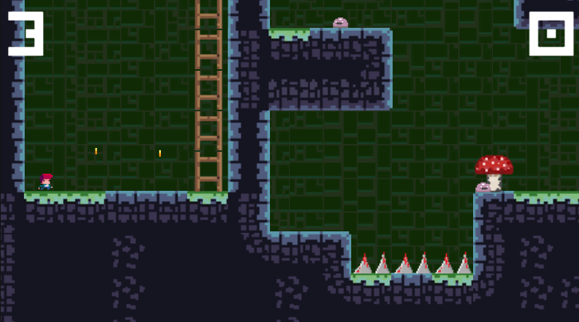
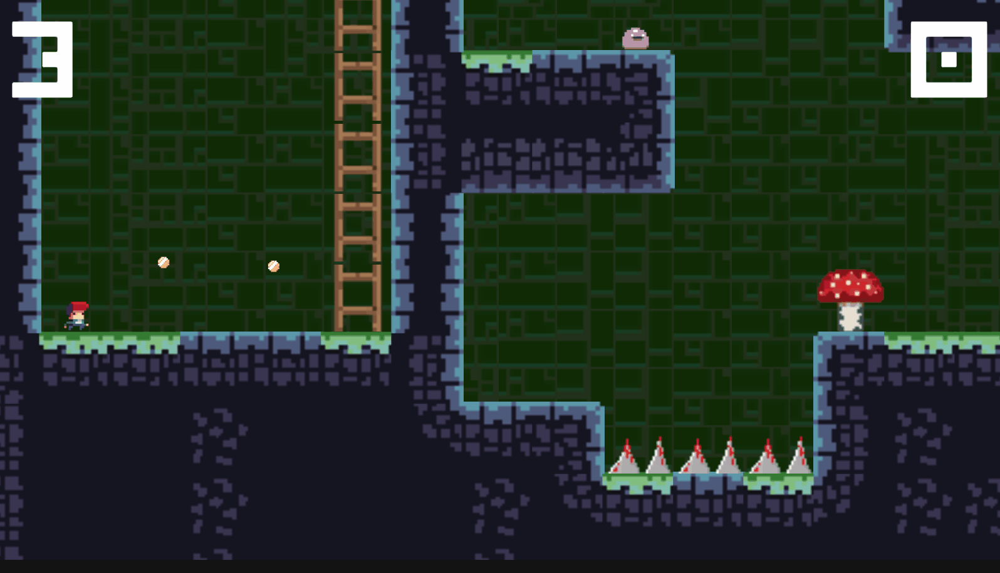

# [TileVania]

Game platformer 2D pixel art làm bằng **Unity** và **C#**. Điều khiển nhân vật khám phá hang động, tránh bẫy gai, leo thang và thu thập coin để lấy điểm.

## Tính năng

- Di chuyển, nhảy và leo thang
- Bẫy gai và chướng ngại vật
- Nhặt coin để tăng điểm, kèm hiệu ứng âm thanh
- Hệ thống mạng và điểm số (`GameSession`)
- Nhiều màn chơi

## Công nghệ

- Unity , C#

## Điều khiển

| Phím | Hành động |
|---|---|
| A / D hoặc ← / → | Di chuyển |
| Space | Nhảy |
| W / S hoặc ↑ / ↓ | Leo thang |

## Chạy từ source

1. Clone repo
2. Mở bằng Unity Hub (đúng phiên bản Unity ở trên)
3. Mở scene `[Level 1]` và nhấn Play

